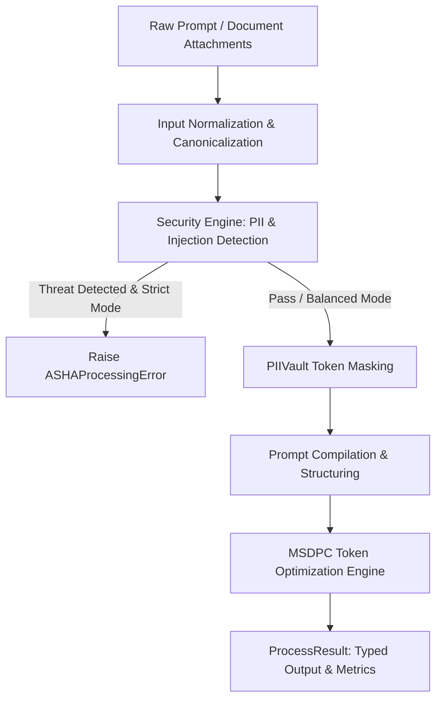

# ASHA-SI Architecture, Optimization & Performance

**Version:** Developer Preview (v0.4.2)  
**Scope:** Pipeline Data Flow, Layer Boundaries, Token Compression Engine (MSDPC), Latency Benchmarks, and Memory Footprint.

---

## 1. End-to-End Processing Pipeline

ASHA processes prompts through a compiler-inspired three-stage pipeline:



- **`process()`**: Executes all three stages (Security → Compilation → Optimization).
- **`sanitize()`**: Executes the Security engine only (PII detection and vault masking).
- **`optimize()`**: Executes the Optimization engine only (token compression and whitespace trimming).

---

## 2. Architectural Boundaries & Package Layout

ASHA enforces strict, unidirectional module boundaries (enforced by `tests/architecture/test_boundaries.py`):

| Layer | Directory | Permitted Dependencies | Must NEVER Import From |
|---|---|---|---|
| **Core** | `src/asha/core/` | Python stdlib, lightweight parsers | `runtime`, `integrations`, `compat` |
| **Runtime** | `src/asha/runtime/` | `core`, `types`, `utils` | `integrations`, `compat` |
| **Types** | `src/asha/types/` | Pure dataclasses | `runtime`, `integrations`, `compat` |
| **Utils** | `src/asha/utils/` | `core`, `runtime`, `types` | `compat` |
| **Integrations** | `src/asha/integrations/`| `core`, `runtime`, provider SDKs | `compat` |

This guarantee ensures that `from asha import process` executes in under 5ms without triggering imports of heavy frameworks (PyTorch, Transformers, spaCy, LangChain).

---

## 3. Token Optimization Engine (MSDPC)

The Multi-Stage Dynamic Prompt Compressor (MSDPC) minimizes prompt token consumption while strictly preserving instruction semantics and variable bindings:

### 3.1 Compression Strategies
1. **Syntactic Whitespace Compaction:** Collapses redundant blank lines and trailing spaces while preserving markdown code blocks and YAML/JSON indents.
2. **Repetitive Boilerplate Pruning:** Strips unnecessary conversational filler (e.g., `Please kindly respond to the following question thoroughly`).
3. **Budget Enforcement (`token_budget`):** Guarantees that the output token count does not exceed the caller's ceiling:
   ```python
   from asha import optimize
   # Compresses prompt to fit strictly within 500 tokens
   result = optimize(verbose_text, token_budget=500)
   print(result.metrics.tokens_saved)
   ```

### 3.2 Semantic Preservation Guarantees
- Code snippets (````python ... ````) and indented blocks are never stripped or altered.
- PII placeholders (`<EMAIL_1>`) injected by `PIIVault` are locked as immutable tokens.

---

## 4. Latency & Resource Performance

Measurements conducted on standard x86_64 CPU hardware (Intel Core i7 / AMD Ryzen):

| Component / Entry Point | Cold Start (Imports) | Warm P50 Latency | Warm P95 Latency | Memory Overhead |
|---|---|---|---|---|
| **`process(mode='lite')`** | < 15 ms | **~1.8 ms** | ~3.5 ms | ~25 MB |
| **`process(mode='balanced')`** | < 25 ms | **~4.2 ms** | ~8.5 ms | ~45 MB |
| **`process(mode='strict')`** | < 25 ms | **~4.5 ms** | ~9.2 ms | ~48 MB |
| **`PIIVault.mask() / unmask()`** | < 1 ms | **~0.4 ms** | ~0.9 ms | < 2 MB |
| **`StreamRehydrator.feed()`** | < 0.1 ms | **~0.05 ms** | ~0.1 ms | < 0.1 MB |

### Running Local Benchmarks
Verify the exact latency on your hardware:

```bash
# Run local benchmark harness
python benchmarks/run_benchmarks.py --save

# Compare against committed baseline
python benchmarks/run_benchmarks.py --compare benchmarks/baseline/results.json
```
